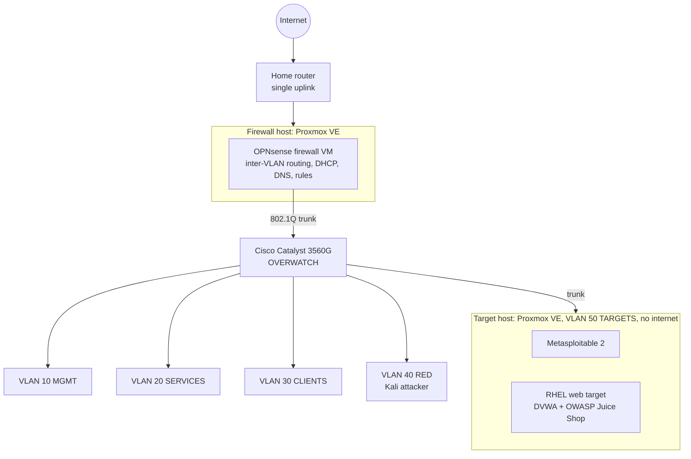

# IRONFORGE Home Lab

**Tags:** #homelab #proxmox #opnsense #vlan #cisco #virtualization

IRONFORGE is my self-built lab for practicing infrastructure, networking, and security. It's built mostly from used and refurbished gear.

> **Status (November 2026):** The network was rebuilt from zero and is live: a virtualized firewall, a managed core switch, five segmented VLANs (virtual local area networks), and an isolated target range. The first attack exercise (SQL injection) has been run against it.

> **AI assistance:** I did the hands-on work: hardware, cabling, installs, configuration and testing. An AI assistant (Claude, by Anthropic) guided the build step by step, proposed the design, supplied commands and helped verify results.

## Network Design

Router-on-a-stick: one firewall routes between VLANs over a single 802.1Q trunk to the core switch. Only the firewall's WAN (wide area network) port touches the house network.

| Segment | Purpose | Policy |
| --- | --- | --- |
| 10 MGMT | Hypervisors, switch, admin laptop | Full access |
| 20 SERVICES | Lab services | DNS (Domain Name System) + internet only |
| 30 CLIENTS | Client machines | DNS + internet only |
| 40 RED | Attack machines | DNS, attack lane to TARGETS; internet off unless toggled for updates |
| 50 TARGETS | Vulnerable targets | No internet, no outbound access (default deny) |
| 999 PARKING | Unused switch ports | Shut down |

## Build Status

| Piece | Status |
| --- | --- |
| Proxmox VE firewall host with OPNsense VM | Done |
| Cisco 3560G: wiped, base config, SSH-only management | Done |
| VLANs, 802.1Q trunk, DHCP (Dynamic Host Configuration Protocol) per segment | Done |
| Per-segment firewall rules, tested from each segment | Done |
| Unused switch ports parked and shut down | Done |
| Cold-start test (whole lab recovers from power-off) | Done |
| Second Proxmox host as an isolated target range | Done |
| Targets: Metasploitable 2, RHEL web target with DVWA and Juice Shop | Done |
| RED → TARGETS attack lane validated; Lab 01 SQL injection run | Done |
| Port security on the management port | Next |
| SPAN (Switched Port Analyzer) to a blue-team sensor | Planned |
| Switch IOS (Internetwork Operating System) upgrade | Planned |
| Tripp-Lite UPS (uninterruptible power supply) monitoring on a Raspberry Pi 5 | Planned |
| Windows Active Directory target | Planned |

## Hardware

| Role | Hardware |
| --- | --- |
| Firewall host | HP OmniDesk Slim S03, Intel i3-13100, Intel 4-port gigabit NIC, Proxmox VE + OPNsense VM |
| Core switch | Cisco Catalyst 3560G 24-port (replaced a Netgear M4100, see [recovery write-up](../networking/netgear-m4100-switch-recovery.md)) |
| Target host | HP OmniDesk Slim M02, Ryzen 7 8700G, 32 GB, Proxmox VE |
| Workstation / local AI | Ryzen 9 9900X3D, RTX 5080 16 GB, 64 GB DDR5 |
| Power | Tripp-Lite SU1500XLCD UPS |

## Virtual Machines

- **Red Hat Enterprise Linux (RHEL) 10:** three VMs in VMware Workstation (two managed nodes, one controller) for Linux administration practice. Full write-up: [rhel-ops-lab](https://github.com/waegns/rhel-ops-lab).
- **Kali Linux, Metasploitable 2 and the RHEL web target:** offensive security practice inside the segmented range. Earlier work: [vsFTPd lab](../offensive/vsftpd-backdoor-exploit.md).
- **Ollama:** runs local models (Qwen, DeepSeek-R1) for [Scribe](https://github.com/waegns/scribe) and [Part Scout](../projects/part-scout.md).

## History

The first version of the lab ran pfSense on a Beelink mini PC, with a Netgear M4100 that I recovered from a locked state, plus WireGuard and RDP/VNC remote access. In November 2026 I wiped every box and rebuilt from zero so the baseline works before anything else gets added. Remote access will come back after the baseline is hardened.
