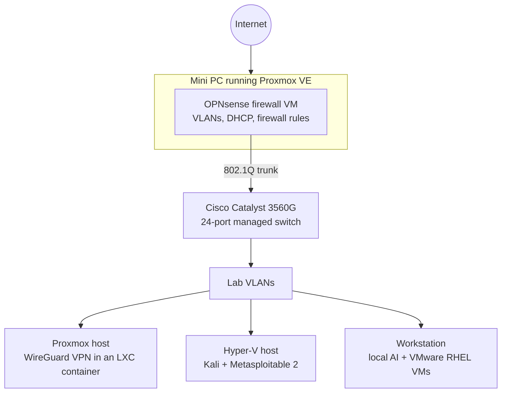

# IRONFORGE Home Lab

**Tags:** #homelab #proxmox #opnsense #vlan #cisco #virtualization

IRONFORGE is my self-built lab for practicing infrastructure, networking, and security. It's built mostly from used and refurbished gear.

> **Status:** The physical network is packed up while I move between two locations. In the meantime I practice on virtual machines that I reach remotely.

## Network Design (in progress)

Router-on-a-stick: one firewall routes between VLANs over a single 802.1Q trunk to the core switch.

| Piece | Status |
| --- | --- |
| OPNsense VM on Proxmox: VLAN interfaces, DHCP scopes, firewall pass rules | Configured |
| Cisco Catalyst 3560G: trunk port and VLAN assignments | Next step |
| WireGuard VPN in an LXC container on Proxmox | Configured |
| RDP / VNC remote access across lab machines | Configured |
| Tripp-Lite SU1500XLCD UPS monitoring | Planned |
| Raspberry Pi 5 | Planned |

## Hardware

| Role | Hardware |
| --- | --- |
| Firewall / hypervisor | Beelink mini PC, Proxmox VE + OPNsense VM |
| Core switch | Cisco Catalyst 3560G 24-port (replaced a Netgear M4100, see [recovery write-up](../networking/netgear-m4100-switch-recovery.md)) |
| Security lab host | HP OmniDesk Slim, Ryzen 7 8700G, 32 GB, Windows 11 Pro + Hyper-V |
| Workstation / local AI | Ryzen 9 9900X3D, RTX 5080 16 GB, 64 GB DDR5 |
| Target host | Older HP OmniDesk running Proxmox |
| Power | Tripp-Lite SU1500XLCD UPS |

## Virtual Machines

- **Red Hat Enterprise Linux (RHEL) 10:** three VMs in VMware Workstation (two managed nodes, one controller) for Linux administration practice. Registered with Red Hat and networked by name on a static host-only segment; SSH key access is next. Full write-up: [rhel-ops-lab](https://github.com/waegns/rhel-ops-lab).
- **Kali Linux and Metasploitable 2:** offensive security practice on an isolated network. See the [vsFTPd lab](../offensive/vsftpd-backdoor-exploit.md).
- **Ollama:** runs local models (Qwen, DeepSeek-R1) for [Scribe](https://github.com/waegns/scribe) and [Part Scout](../projects/part-scout.md).

## History

The first version of the lab ran pfSense, with a Netgear M4100 that I recovered from a locked state. I'm rebuilding it from zero, so the baseline works before anything else gets added.
