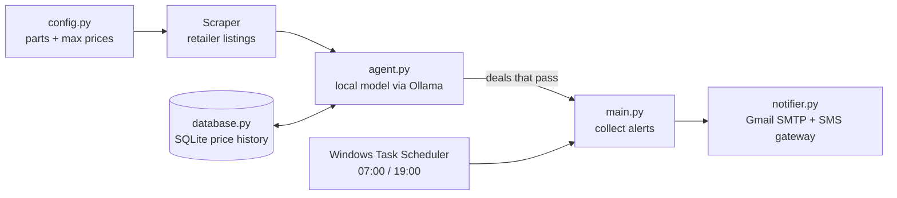

# Part Scout: Automated PC Parts Deal Tracker

**Tags:** #python #automation #web-scraping #local-llm #sqlite #notifications

## The Problem

Every day I was digging through about 30 sale emails and checking 4 retailer sites for parts for my lab build. Part Scout does that for me and only alerts me when a price is actually worth acting on.

## What It Does

1. Checks retailer listings for each part on a target list, each with its own maximum price.
2. Sends the listings to a **local language model through Ollama**, which picks the best option and decides between buy and wait.
3. Logs every price check to **SQLite** so each new price can be compared against history.
4. Flags a deal only when the price is **under budget AND at least 8% below** what it has been.
5. Collects every flagged deal into **one combined alert**, sent by email and by text message through the carrier's email-to-SMS gateway.
6. Runs automatically at **07:00 and 19:00** through Windows Task Scheduler.

## Architecture

| Module | Role |
| --- | --- |
| `config.py` | Target parts and maximum prices |
| `database.py` | SQLite price history |
| `agent.py` | Prompts the local model; requires under budget and an 8%+ discount before setting `alert: true` |
| `notifier.py` | Sends alerts through Gmail SMTP and the SMS gateway |
| `main.py` | Runs the checks and sends one combined notification |
| `schedule_setup.bat` | Registers the twice-daily Windows scheduled task |

## Security

- Credentials are kept in **environment variables** (`setx`), never in the code.
- Uses a **Gmail app password** instead of the real account password.

## What Broke and What I Learned

| Problem | Root cause | Fix |
| --- | --- | --- |
| Alert noise: everything looked like a deal | The first logic flagged any price under budget | Required a real discount (8%+) against price history |
| Alerts never arrived | `send_alert()` was never called from `main.py` | Traced the full execution path from detection to notification |
| Model output wouldn't parse | Model sometimes nested fields or wrapped the JSON in extra text | Parsed the outermost JSON object and handled both flat and nested fields |
| Script couldn't see the password variable | Typed the whole instruction into PowerShell instead of just the `setx` command; old session didn't reload | Ran only `setx`, reopened PowerShell, and checked with `echo $env:GMAIL_APP_PASS` |

## Status

Working on my workstation. The source code isn't published yet; this page documents the design and what I learned building it.
